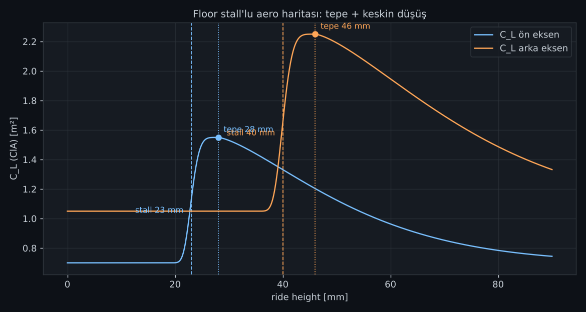
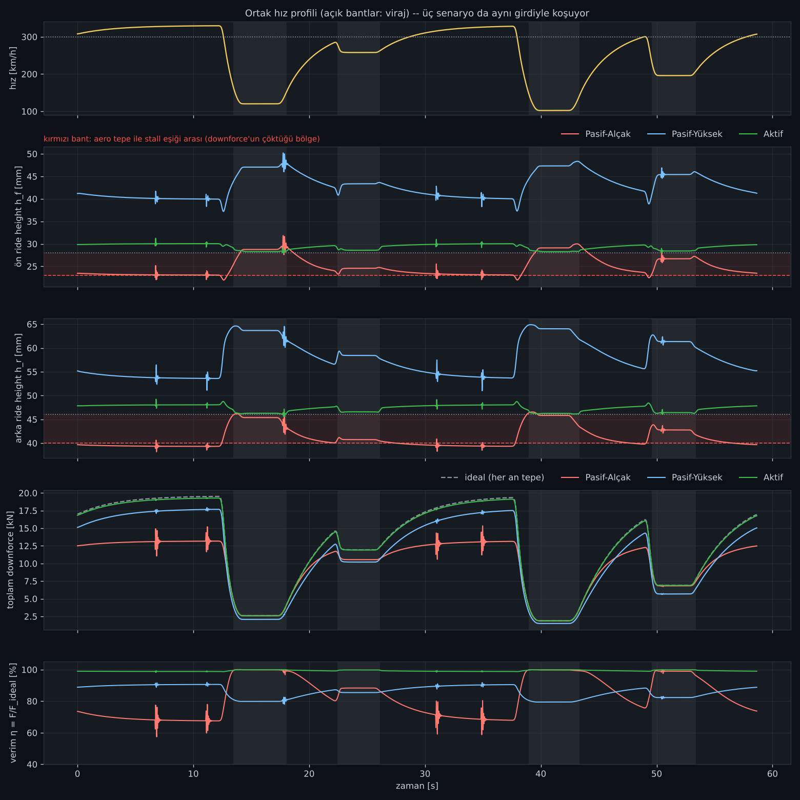
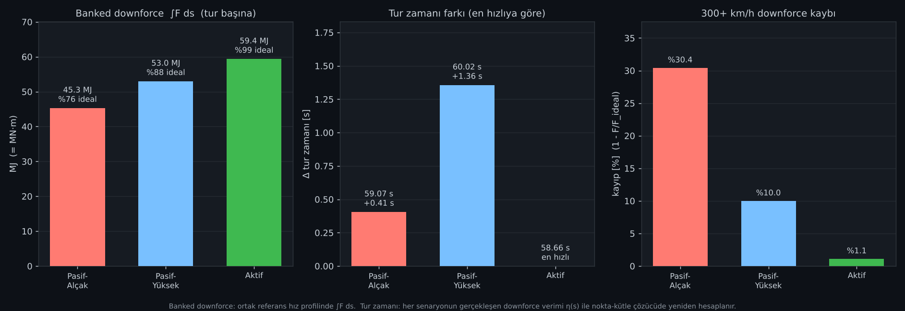
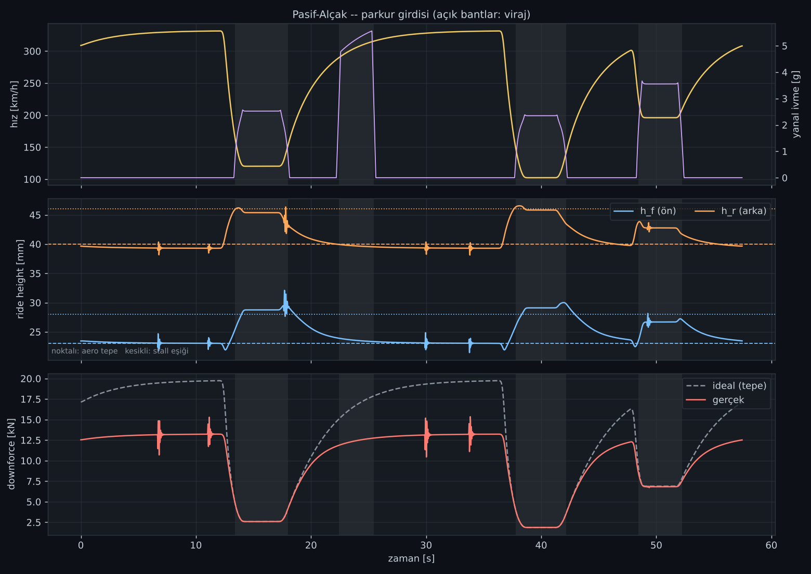
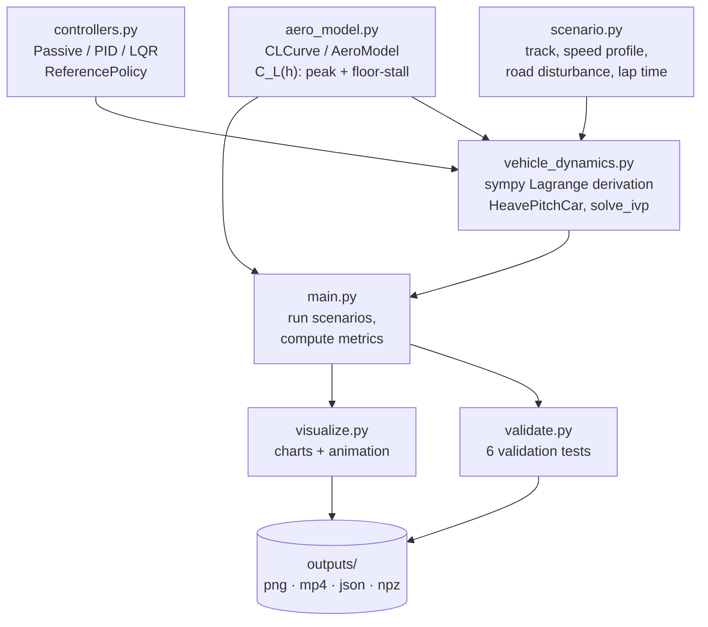

# F1 Active Suspension Simulation

[](LICENSE)
[](https://www.python.org/)


> *A 2-DOF (heave + pitch) Formula 1 car model, with ride-height-dependent "floor-stall" aerodynamics, compared against an LQR/PID ride-height controller that revives the **active suspension** concept banned from F1 in 1994.*

🇹🇷 Türkçe sürüm: [README.md](README.md)

---

## Table of contents
- [What is this?](#what-is-this)
- [Visuals](#visuals)
- [Architecture / data flow](#architecture--data-flow)
- [Model summary](#model-summary)
- [Code layout](#code-layout)
- [Setup and usage](#setup-and-usage)
- [Results](#results)
- [Validation tests](#validation-tests)
- [Assumptions and limitations](#assumptions-and-limitations)
- [References](#references)
- [Attribution](#attribution)
- [License](#license)

## What is this?

This project simulates the **ride height** (chassis-to-ground gap) behavior of a Formula 1 car under three different suspension strategies, and compares their effect on **downforce**, **lap time**, and **high-speed aero loss**:

| Scenario | Description |
|---|---|
| **Passive-Low** | Fixed, low static ride height (targets maximum ground effect, but risks stall under braking/cornering) |
| **Passive-High** | Fixed, high static ride height (low stall risk, but sacrifices average downforce) |
| **Active** | LQR/PID-controlled ride-height regulation; the reference dynamically hugs the aero peak, adapted by speed and corner mode |

All three scenarios run over **the same track with the same reference speed profile**, keeping downforce and lap-time comparisons fair (see [Model summary](#model-summary)).

The physics engine is not built from hand-derived differential equations — the Euler–Lagrange equations are derived symbolically with `sympy`, then numerically integrated over time with `scipy.integrate.solve_ivp`.

## Visuals

| Aero C_L(h) curve | Three-scenario comparison (time series) |
|---|---|
|  |  |

| Summary metrics | Validation (Passive-Low) |
|---|---|
|  |  |

Live animation (side-view car schematic + scrolling charts): [`outputs/animasyon.mp4`](outputs/animasyon.mp4)

## Architecture / data flow



## Model summary

- **Degrees of freedom:** body heave (`z`) and pitch (`θ`); front/rear ride height `h_f, h_r` are a linear transform of these (`y_f = z + aθ`, `y_r = z − bθ`, `h_i = y_i − w_i`).
- **Equations of motion:** kinetic/potential/Rayleigh-dissipation energy expressions (`T, V, R`) are built in `sympy`, the Euler–Lagrange equations are solved symbolically and converted to a fast numeric function with `sp.lambdify` — no hand-derived closed-form equations.
- **Aerodynamics (`aero_model.py`):** each axle's `C_L(h)` curve is built from two "stretched-exponential" half-curves of different width/sharpness joined at the peak (`h_peak`) — a soft roll-off on the high side, and a sharp "floor stall" collapse as the car approaches `h_stall` on the low side. This models the ground-effect loss that causes porpoising in real F1 cars.
- **Controllers (`controllers.py`):**
  - *Passive*: no actuator, `u = 0`.
  - *PID*: independent per-axle PID, `u = kp·e + ki·∫e + kd·ė`.
  - *LQR*: integral-augmented state feedback; state `z = [e, ė, ∫e, u_act]`, Riccati solution via `solve_continuous_are`, `u = −K z`.
  - `ReferencePolicy`: reference ride height is `h_peak + margin`; the margin grows with the square of speed on straights (safety margin against stall at high speed) and shrinks in corner mode (hug the peak).
  - Actuator: first-order lag (`tau_act = 15 ms`), `±15 kN` saturation, anti-windup via conditional integration.
- **Track and speed profile (`scenario.py`):** a curvature profile is built from straight/corner segments; the reference speed profile comes from a point-mass, friction-circle, power-limited forward/backward pass solver (shared by all scenarios). Road disturbance is a periodic sum of Gaussian bumps/dips.
- **Fair comparison / lap time:** all three scenarios run with the same ideal-aero reference speed profile (fair downforce comparison). Each scenario's realized efficiency curve `η(s) = F_actual/F_ideal` is then fed back into the speed-profile solver → scenario-specific lap time.

## Code layout

| File | Contents |
|---|---|
| `aero_model.py` | `CLCurve`: asymmetric stretched-exponential `C_L(h)`. `AeroModel`: front+rear curve combination, downforce and drag |
| `vehicle_dynamics.py` | `sympy`-derived Lagrangian equations, `HeavePitchCar`, `solve_ivp` integration. State: `[h_f, h_r, ḣ_f, ḣ_r, ∫e_f, ∫e_r, u_f, u_r]` |
| `controllers.py` | `PassiveController`, `PIDController`, `LQRController` (integral action), `ReferencePolicy`, closed-loop pole analysis |
| `scenario.py` | Track definition, point-mass speed-profile solver, road disturbances, time table, lap time |
| `visualize.py` | Dark-themed plots + side-view car schematic / live chart animation |
| `validate.py` | Passive-model validation tests (6 tests) |
| `main.py` | CLI entry point: `curve` / `validate` / `compare` / `animate` |

## Setup and usage

```bash
pip install -r requirements.txt     # animation needs ffmpeg on the system (falls back to GIF otherwise)

python main.py curve                          # aero C_L(h) curve
python main.py validate                       # single scenario (Passive-Low) + 6 validation tests
python main.py compare [--controller pid]     # three-scenario comparison (--anim: also renders mp4)
python main.py animate                        # animation only
python vehicle_dynamics.py                    # print the symbolically derived equations
```

Outputs are written to `outputs/`.

## Results

`python main.py compare` output (`outputs/metrikler.json`):

| Metric | Passive-Low | Passive-High | Active |
|---|---:|---:|---:|
| Banked downforce [MJ] | 45.3 | 53.0 | **59.4** |
| Lap time [s] | 59.07 | 60.02 | **58.66** |
| 300+ km/h downforce loss [%] | 30.4 | 10.0 | **1.1** |

**Takeaway:** Passive-Low has the highest ground-effect ceiling but stalls at high speed, losing ~30% of its downforce; Passive-High avoids stall but sacrifices average downforce. Active suspension keeps the ride height pinned near the aero peak continuously, combining the best of both worlds — highest banked downforce, fastest lap time, and lowest high-speed loss — illustrating exactly the performance edge behind F1's 1994 active-suspension ban.

## Validation tests

`python main.py validate` (`validate.py`) runs **6 independent checks** on the passive model:

1. `sympy`-derived accelerations vs. an independent hand-written closed-form acceleration formula (50 random states, error < 1e-8 m/s²)
2. `v=0` free vibration vs. the matrix-exponential solution of the linear system (`expm(A·t)`) — a fully linear-model cross-check
3. Energy conservation in the undamped system (relative drift < 1e-6)
4. Steady-speed equilibrium vs. an independent scalar force balance (`scipy.optimize.brentq`), at three speeds
5. Braking load transfer (static pitch shift) vs. the analytical formula
6. Full lap (Passive-Low, with road disturbance): ride height stays within a physically sensible range, and settles near the aero peak at low speed / the stall region at high speed

## Assumptions and limitations

- Lap time uses a single feedback iteration (the speed profile is not re-optimized per scenario).
- The drag model (`CdA = cd0 + k_wing·ClA_wing + k_floor·ClA_floor`) assumes downforce lost to stall doesn't reduce drag proportionally; results are sensitive to this assumption.
- Lateral acceleration doesn't feed into heave/pitch dynamics (roll is not modeled); it only affects cornering grip in the lap-time model.
- The aero model is quasi-static (no flow lag), so the passive car settles onto an equilibrium branch at stall rather than oscillating — a flow-lag term would be needed to reproduce true porpoising.
- Actuator power/energy consumption is not modeled, only force saturation (`±15 kN`).

## References

| Topic | Source |
|---|---|
| History of active suspension in F1 and the 1994 ban | FIA technical regulations, 1994 season changes |
| Ground effect / floor stall and porpoising | Public technical discussion following the 2022 F1 technical regulations |
| Lagrangian mechanics for suspension modeling | General vehicle dynamics literature (2-DOF quarter/half-car models) |
| LQR / Riccati-based state feedback | `scipy.linalg.solve_continuous_are` documentation |
| Symbolic derivation | `sympy` documentation |

## Attribution

This project was inspired by a post from the Instagram account **[@veer.alak.sim](https://www.instagram.com/veer.alak.sim/)** explaining the difference between active and passive F1 suspension, and was written to model the subject from scratch with an original physics engine. Active suspension was banned by the FIA in Formula 1 before the 1994 season; this simulation re-creates that technology's performance impact for educational purposes.

## License

[MIT](LICENSE) © 2026 Musa Buğra Demir
