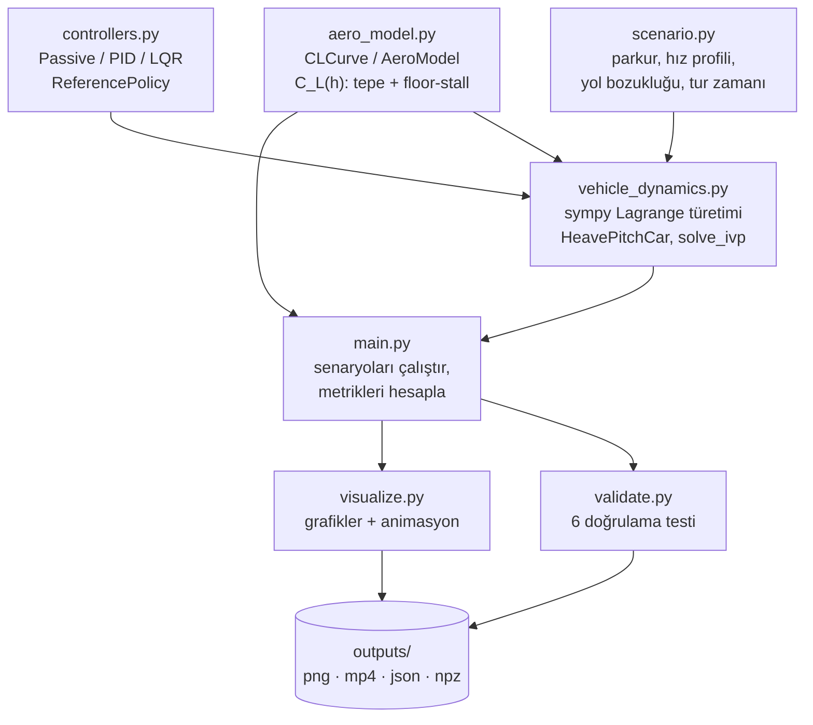

# F1 Aktif Süspansiyon Simülasyonu

[](LICENSE)
[](https://www.python.org/)


> *2-DOF (heave + pitch) bir F1 aracı, ride-height'a bağlı "floor-stall" aerodinamiği ve 1994'te Formula 1'de yasaklanan **aktif süspansiyon** fikrini yeniden canlandıran bir LQR/PID ride-height kontrolcüsü ile karşılaştırılıyor.*

🇬🇧 English version: [README.en.md](README.en.md)

---

## İçindekiler
- [Proje nedir?](#proje-nedir)
- [Görseller](#görseller)
- [Mimari / veri akışı](#mimari--veri-akışı)
- [Model özeti](#model-özeti)
- [Kod yapısı](#kod-yapısı)
- [Kurulum ve çalıştırma](#kurulum-ve-çalıştırma)
- [Sonuçlar](#sonuçlar)
- [Doğrulama testleri](#doğrulama-testleri)
- [Varsayımlar ve sınırlar](#varsayımlar-ve-sınırlar)
- [Kaynakça](#kaynakça)
- [Attribution](#attribution)
- [Lisans](#lisans)

## Proje nedir?

Bu proje, bir Formula 1 aracının **ride height** (gövde–zemin mesafesi) davranışını üç farklı süspansiyon stratejisi altında simüle eder ve bunların **downforce**, **tur zamanı** ve **yüksek hızdaki aero kaybı** üzerindeki etkisini karşılaştırır:

| Senaryo | Açıklama |
|---|---|
| **Pasif-Alçak** | Sabit, düşük statik ride height (maksimum zemin etkisi hedefi, ama viraj/fren sırasında stall riski) |
| **Pasif-Yüksek** | Sabit, yüksek statik ride height (stall riski düşük, ama ortalama downforce daha az) |
| **Aktif** | LQR/PID kontrolcülü ride-height regülasyonu; referans, hız ve viraj moduna göre aerodinamik tepe noktasına dinamik olarak yaslanır |

Aracın tüm üç senaryoda **aynı parkuru, aynı referans hız profiliyle** koşması sağlanır; böylece downforce ve tur zamanı kıyaslamaları adil kalır (bkz. [Model özeti](#model-özeti)).

Fizik motoru elle türetilmiş diferansiyel denklemlere değil, `sympy` ile sembolik olarak türetilen Euler–Lagrange denklemlerine dayanır; bu denklemler sayısal olarak `scipy.integrate.solve_ivp` ile zaman içinde entegre edilir.

## Görseller

| Aero C_L(h) eğrisi | Üç senaryo karşılaştırması (zaman serileri) |
|---|---|
|  |  |

| Özet metrikler | Doğrulama (Pasif-Alçak) |
|---|---|
|  |  |

Canlı animasyon (yandan araç şeması + ilerleyen grafikler): [`outputs/animasyon.mp4`](outputs/animasyon.mp4)

## Mimari / veri akışı



## Model özeti

- **Serbestlik dereceleri:** gövde heave (`z`) ve pitch (`θ`); ön/arka ride height `h_f, h_r` bunların doğrusal dönüşümü (`y_f = z + aθ`, `y_r = z − bθ`, `h_i = y_i − w_i`).
- **Denklemler:** `T, V, R` (kinetik, potansiyel, Rayleigh sönüm) enerji ifadeleri `sympy` ile kurulur, Euler–Lagrange denklemleri sembolik çözülür ve `sp.lambdify` ile hızlı sayısal fonksiyona dönüştürülür — elle türetilmiş kapalı-form denklem yok.
- **Aerodinamik (`aero_model.py`):** Her eksen için `C_L(h)` eğrisi, tepe noktasının (`h_peak`) iki yanında farklı genişlik/keskinlikte "stretched-exponential" yarı-eğrilerin birleşiminden oluşur — yüksek tarafta yumuşak düşüş, alçak tarafta (`h_stall`'a yaklaşırken) keskin "floor stall" çöküşü. Bu, gerçek F1 araçlarındaki ground-effect/porpoising kaynağı olan zemin etkisi kaybını modeller.
- **Kontrolcüler (`controllers.py`):**
  - *Pasif*: aktüatör yok, `u = 0`.
  - *PID*: eksen başına bağımsız PID, `u = kp·e + ki·∫e + kd·ė`.
  - *LQR*: integral etkili durum geri beslemesi; durum `z = [e, ė, ∫e, u_akt]`, `solve_continuous_are` ile Riccati çözümü, `u = −K z`.
  - `ReferencePolicy`: referans ride height `h_peak + pay`; pay düzlükte hızın karesiyle büyür (yüksek hızda stall'a girmemek için güvenlik payı), virajda küçülür (tepeye yaslan).
  - Aktüatör: 1. derece gecikme (`tau_act = 15 ms`), `±15 kN` doyma, koşullu integrasyon ile anti-windup.
- **Parkur ve hız profili (`scenario.py`):** düzlük+viraj segmentlerinden eğrilik profili, nokta-kütle + sürtünme çemberi + güç sınırlı ileri/geri geçiş çözücüsüyle referans hız profili (tüm senaryolara ortak). Gauss tümsek/çukurlardan periyodik yol bozukluğu.
- **Adil kıyas / tur zamanı:** Üç senaryo da aynı ideal-aero referans hız profiliyle koşar (adil downforce kıyası). Sonra her senaryonun gerçekleşen verim eğrisi `η(s) = F_gerçek/F_ideal` ile hız profili çözücüsü yeniden çalıştırılır → senaryoya özgü tur zamanı.

## Kod yapısı

| Dosya | İçerik |
|---|---|
| `aero_model.py` | `CLCurve`: asimetrik stretched-exponential `C_L(h)`. `AeroModel`: ön+arka eğri birleşimi, downforce ve sürükleme hesabı |
| `vehicle_dynamics.py` | `sympy` ile Lagrange türetimi, `HeavePitchCar`, `solve_ivp` entegrasyonu. Durum: `[h_f, h_r, ḣ_f, ḣ_r, ∫e_f, ∫e_r, u_f, u_r]` |
| `controllers.py` | `PassiveController`, `PIDController`, `LQRController` (integral etkili), `ReferencePolicy`, kapalı çevrim kutup analizi |
| `scenario.py` | Parkur tanımı, nokta-kütle hız profili çözücüsü, yol bozuklukları, zaman tablosu, tur zamanı |
| `visualize.py` | Koyu tema grafikler + yandan araç şeması / canlı grafik animasyonu |
| `validate.py` | Pasif model doğrulama testleri (6 test) |
| `main.py` | CLI giriş noktası: `curve` / `validate` / `compare` / `animate` |

## Kurulum ve çalıştırma

```bash
pip install -r requirements.txt     # animasyon için sistemde ffmpeg gerekir (mp4 yoksa gif'e düşer)

python main.py curve                          # aero C_L(h) eğrisi
python main.py validate                       # tek senaryo (Pasif-Alçak) + 6 doğrulama testi
python main.py compare [--controller pid]     # üç senaryo karşılaştırması  (--anim: mp4 de üretir)
python main.py animate                        # sadece animasyon
python vehicle_dynamics.py                    # sympy ile türetilmiş sembolik denklemleri yazdır
```

Çıktılar `outputs/` klasörüne yazılır.

## Sonuçlar

`python main.py compare` çıktısı (`outputs/metrikler.json`):

| Metrik | Pasif-Alçak | Pasif-Yüksek | Aktif |
|---|---:|---:|---:|
| Banked downforce [MJ] | 45.3 | 53.0 | **59.4** |
| Tur zamanı [s] | 59.07 | 60.02 | **58.66** |
| 300+ km/h downforce kaybı [%] | 30.4 | 10.0 | **1.1** |

**Yorum:** Pasif-Alçak en yüksek zemin etkisi potansiyeline sahip olsa da yüksek hızda floor-stall'a girip downforce'un %30'unu kaybediyor; Pasif-Yüksek stall'dan korunuyor ama ortalama downforce'tan ödün veriyor. Aktif süspansiyon, ride height'ı sürekli aero tepe noktasına yakın tutarak her iki senaryonun avantajını birleştirir: en yüksek banked downforce, en düşük tur zamanı ve en düşük yüksek-hız kaybı — tam da 1994'te F1'de aktif süspansiyonun yasaklanmasının arkasındaki performans avantajını gösteriyor.

## Doğrulama testleri

`python main.py validate` (`validate.py`) pasif model için **6 bağımsız doğrulama** çalıştırır:

1. `sympy` ile türetilen ivmeler vs. elle yazılmış bağımsız kapalı-form ivme formülü (50 rastgele durum, hata < 1e-8 m/s²)
2. `v=0` serbest titreşim vs. doğrusal sistemin matris üsteli çözümü (`expm(A·t)`) — tam doğrusal model karşılaştırması
3. Sönümsüz sistemde enerji korunumu (göreli sapma < 1e-6)
4. Sabit hızda denge noktası vs. bağımsız skaler kuvvet dengesi (`scipy.optimize.brentq`), üç farklı hızda
5. Fren yük aktarımı (statik pitch kayması) vs. analitik formül
6. Tam tur (Pasif-Alçak, yol bozukluklu): ride height'ın fiziksel aralıkta kalması ve düşük hızda aero tepesine / yüksek hızda stall bölgesine oturması

## Varsayımlar ve sınırlar

- Tur zamanı tek iterasyonlu geri besleme ile hesaplanır (hız profili senaryoya göre tekrar optimize edilmez).
- Sürükleme modeli (`CdA = cd0 + k_wing·ClA_kanat + k_floor·ClA_zemin`) stall'da kaybolan downforce'un sürüklemeyi de aynı oranda düşürmediğini varsayar; sonuçlar bu varsayıma duyarlıdır.
- Yanal ivme heave/pitch dinamiğine girmez (roll modellenmedi); sadece tur zamanı modelinde viraj tutuşunu etkiler.
- Aero modeli kuasi-statiktir (akış gecikmesi yok) → gerçek porpoising osilasyonu için aero gecikmesi eklenmelidir.
- Aktüatör gücü/enerji tüketimi hesaba katılmaz, sadece kuvvet doyması (`±15 kN`) modellenir.

## Kaynakça

| Konu | Kaynak |
|---|---|
| F1'de aktif süspansiyon tarihi ve 1994 yasağı | FIA teknik düzenlemeleri, 1994 sezonu değişiklikleri |
| Ground-effect / floor stall ve porpoising | 2022 F1 teknik regülasyonu sonrası kamuya açık teknik tartışmalar |
| Lagrange mekaniği ile araç süspansiyon modellemesi | Genel araç dinamiği literatürü (2-DOF quarter/half-car modelleri) |
| LQR / Riccati tabanlı durum geri beslemesi | `scipy.linalg.solve_continuous_are` dokümantasyonu |
| Sembolik türetim | `sympy` dokümantasyonu |

## Attribution

Bu proje, Instagram'daki **[@veer.alak.sim](https://www.instagram.com/veer.alak.sim/)** hesabının F1 aktif/pasif süspansiyon farkını anlatan paylaşımından esinlenilerek, konuyu kendi fizik motorumla sıfırdan modellemek amacıyla yazılmıştır. Aktif süspansiyon, 1994 sezonu öncesinde FIA tarafından F1'de yasaklanmıştır; bu simülasyon o teknolojinin performans etkisini eğitim amaçlı yeniden canlandırır.

## Lisans

[MIT](LICENSE) © 2026 Musa Buğra Demir
